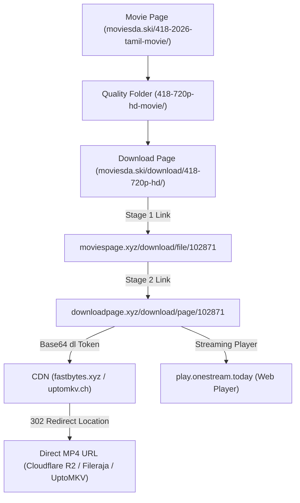

# Moviesda & isaiDub Scraper & Direct MP4 Link Resolver

A dedicated, standalone Python web scraper and direct link resolver for **[moviesda.ski](https://moviesda.ski)** (Moviesda / Isaimini) and **[isaidub.green](https://isaidub.green)** (isaiDub Tamil Dubbed Movies).

---

## Key Features

- 🕷️ **Full Dual-Site Catalog Scraping**: Discovers releases by Year (2026, 2025, 2024...), Category, Web Series, Dubbed movies, and A-Z alphabetical index on both **Moviesda** and **isaiDub**.
- ⚡ **Anti-Leech Gateway Resolver**: Fully automated 3-stage resolution that cracks the redirect protection on both networks (`moviespage.xyz` & `dubpage.xyz`) and retrieves **direct, streamable high-speed MP4 URLs** and in-browser **Watch Online** links (`onestream.today`).
- 📁 **Recursive Folder Navigation**: Traverses nested quality subfolders (e.g., `Original` ➔ `1080p HD` / `720p HD` / `360p HD`) to discover every available file variant and size.
- 🔍 **SQLite FTS5 Full-Text Search**: Ultra-fast offline search across movie titles, clean names, director, cast, and genres, with automatic multi-site live folder fallback search.
- 🖥️ **Interactive CLI**: Search movies, browse updates, sync years/all folders across either or both sites, and extract direct download links directly in your terminal.
- 🔌 **Standalone MCP Server**: Exposes tools for Claude Code or Claude Desktop.

---

## How Moviesda Anti-Leech Architecture Works

Moviesda uses a multi-tier obfuscation architecture before delivering files:



1. **Stage 0 (`moviesda.ski/download/<slug>/`)**: Extracts file metadata (Name, Size, Duration, Format, Resolution) and the initial server gateway link.
2. **Stage 1 (`download.moviespage.xyz/download/file/<id>`)**: Anti-hotlink validation layer.
3. **Stage 2 (`movies.downloadpage.xyz/download/page/<id>`)**: Generates an encrypted `dl` token (base64 encoded server, file path, hash, and expiration).
4. **Stage 3 (`fastbytes.xyz` / `uptomkv.ch`)**: Sending a request with `allow_redirects=False` reads the `Location` header containing the **direct high-speed MP4 URL** (e.g. Cloudflare R2 / Fileraja storage).

---

## Project Structure

```text
isaimini/
├── scraper.py       # High-performance requests & BeautifulSoup scraper + link resolver
├── db.py            # SQLite schema (movies, movie_files, categories) with FTS5
├── cli.py           # Command-line interface with interactive mode & CLI subcommands
├── server.py        # FastMCP server for Claude Code / Claude Desktop integration
├── test_run.py      # Automated end-to-end verification script
├── requirements.txt # Python dependencies (requests, beautifulsoup4, mcp)
└── README.md        # Documentation
```

---

## Setup & Installation

```bash
cd isaimini
pip install -r requirements.txt
```

---

## CLI Usage

### 1. View Latest Releases Ticker
```bash
python cli.py latest
```

### 2. Search Movies across All Folders
Searches local SQLite cache instantly with automatic live folder crawl fallback:
```bash
python cli.py search "Vikram"
python cli.py search "Leo"
python cli.py search "Sardar"
```

### 3. Crawl & Index ALL Folders (Multi-Folder Sync)
Crawls across multiple folders concurrently (Years, Series, Dubbed, A-Z) using high-speed threads:
```bash
# Sync top pages across all year folders (2012-2026)
python cli.py sync-all --type years --pages 2

# Complete alphabetical sync (crawls all movies A-Z)
python cli.py sync-all --type atoz

# Sync everything (all folders on the website)
python cli.py sync-all --type all
```

### 4. Sync Movies for a Single Release Year
```bash
# Sync page 1 and 2 of 2026 Tamil movies
python cli.py sync --year 2026 --pages 2

# Sync with full details (director, cast, synopsis)
python cli.py sync --year 2026 --pages 1 --with-details
```

### 4. Inspect Movie Information
```bash
python cli.py info "https://moviesda.ski/418-2026-tamil-movie/"
```

### 5. Discover & Resolve Direct MP4 Download Links
Works seamlessly on both Moviesda and isaiDub URLs:
```bash
# Moviesda
python cli.py links "https://moviesda.ski/418-2026-tamil-movie/"

# isaiDub
python cli.py links "https://isaidub.green/movie/survive-2024-tamil-dubbed-movie/"
```
Output:
```text
Discovered 4 file variant(s):

[1] 418 2026 HQ PreDVD 720p HD.mp4
    Quality: 720p | Size: 1.52 GB | Format: Mp4
    Page URL: https://moviesda.ski/download/418-2026-hq-predvd-720p-hd/
    Resolving 3-stage anti-leech gateway...
    --> DIRECT MP4:     https://site.fileraja.click/418_2026_HQ_PreDVD_720p_HD.mp4?htag=...
    --> WATCH ONLINE:   https://play.onestream.today/stream/page/102871
    --> Duration:       02:08:14 min | Res: 1280x544
```

### 6. Interactive Mode
Run without arguments for an interactive menu:
```bash
python cli.py
```

### 7. Database Statistics
```bash
python cli.py stats
```

---

## MCP Server Registration

Add to your `.claude.json` or `claude_desktop_config.json`:

```json
{
  "mcpServers": {
    "isaimini-search": {
      "command": "python",
      "args": ["C:\\Users\\dines\\ClaudeCode\\moviesearch\\isaimini\\server.py"]
    }
  }
}
```

### Available MCP Tools:
- `search_isaimini(query)`
- `get_isaimini_latest()`
- `get_isaimini_movie(url)`
- `get_isaimini_download_links(movie_url, resolve_direct=True)`
- `sync_isaimini_year(year=2026, pages=1)`
- `isaimini_stats()`
